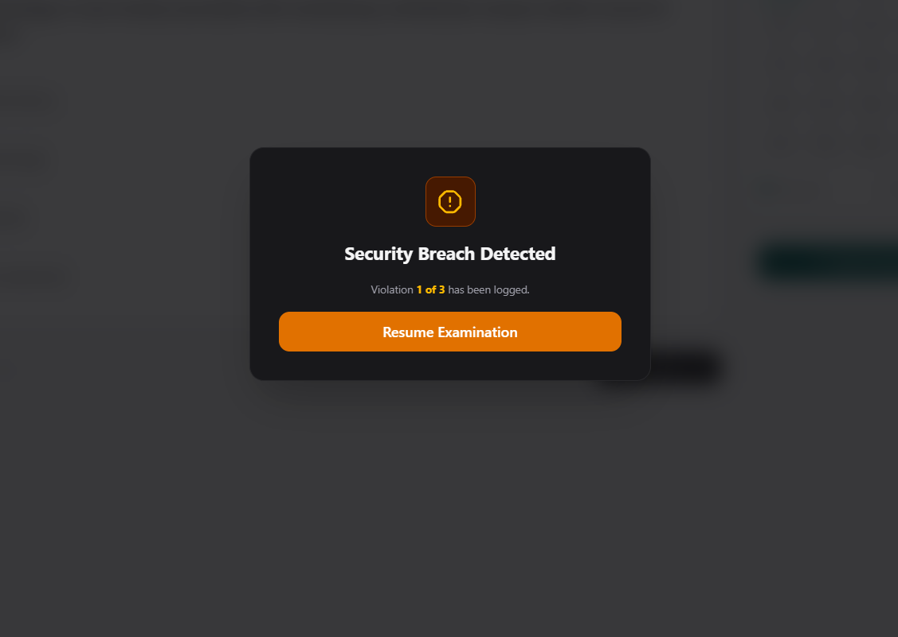
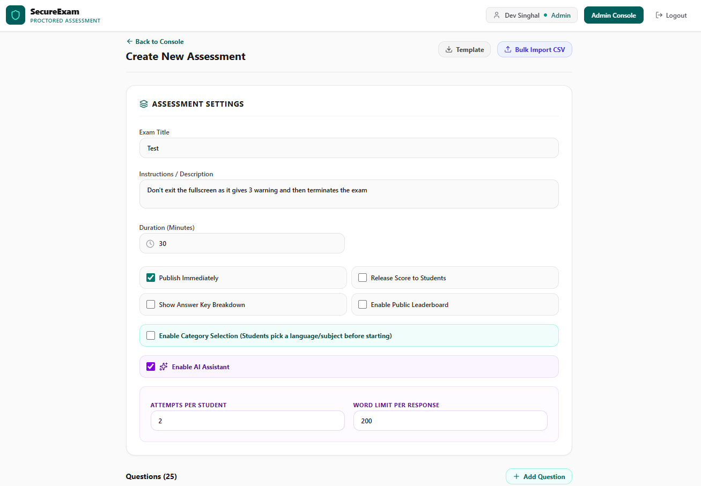
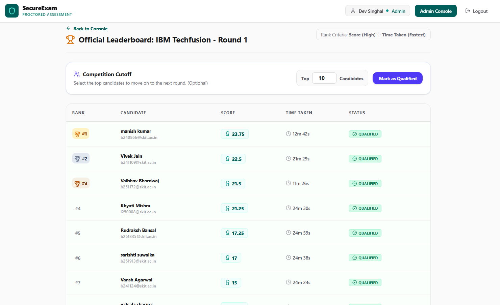
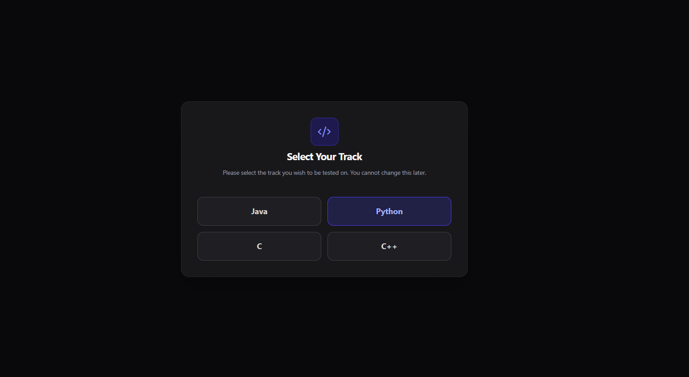
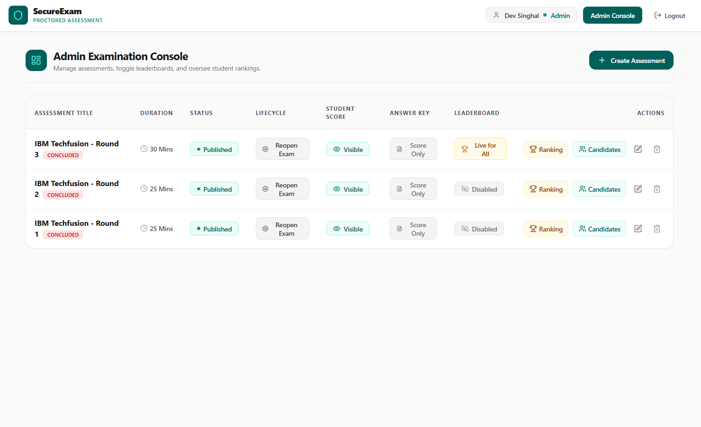

# Secure Proctored Assessment Platform

## 💡 Overview

The Secure Proctored Assessment Platform is a robust, live examination environment built for educational institutions and technical recruiters. Designed to handle high-stakes assessments (like 3-hour coding competitions or case studies), the platform enforces strict anti-cheat proctoring while delivering a seamless, glitch-free experience for candidates.

> "A bulletproof testing environment that balances strict security with intelligent candidate assistance."

Beyond standard question delivery, the platform features a highly configurable admin architecture. Admins can create dynamic language or subject tracks, bulk-import questions via CSV, and enable a tightly controlled, rate-limited AI Assistant powered by Google Gemini to help students with structural guidance during complex case studies.

## ✨ Features

- 🔐 **Secure Authentication** — Custom JWT (JSON Web Token) authentication with bcrypt password hashing ensures persistent, secure sessions without unexpected mid-exam logouts.
- ⏱️ **Bulletproof Server-Anchored Timer** — Countdown logic tied to a MongoDB-stored real-world `end_time` timestamp, completely immune to PC sleep exploits, page refreshes, and network drops.
- 🛡️ **Anti-Cheat Proctoring** — Strict 3-strike fullscreen enforcement. Exiting fullscreen or switching tabs logs a violation. Reaching 3 strikes results in automatic disqualification.
- 🧠 **Configurable AI Assistant** — Integrated Google Gemini (`gemini-3.8-flash`) provides structural hints. Admins can dynamically configure the maximum allowed queries per student and the AI response word limit directly from the dashboard.
- 🔀 **Dynamic Category Tracks** — Admins can enable custom selection screens (e.g., "Select your Tech Stack: React, Java, Python") with customizable titles and instructions that lock candidates into a specific question track.
- 📁 **CSV Bulk Import** — Quickly construct exams by downloading a template and uploading hundreds of questions (Single Choice, Multiple Choice, True/False, Descriptive) in seconds.
- ⚡ **Real-Time Terminations** — Powered by **Socket.io WebSockets**, admins can instantly terminate a candidate's live session from the dashboard, immediately locking their screen and submitting their current progress.
- 📊 **Flexible Scoring Engine** — Support for custom positive marks and negative mark penalties for incorrect answers, with manual grading interfaces for descriptive questions.
- 🛠️ **Admin Dashboard** — Create, edit, and publish exams, toggle result visibility, and view live candidate submissions and leaderboards.

## 👩‍💻 Tech Stack

**Backend (Node.js)**

- Express.js (REST API)
- MongoDB & Mongoose (Database & ORM)
- Socket.io (WebSocket real-time events)
- JSON Web Tokens (JWT) & bcrypt (Authentication)
- AI Integration: Google Gemini API (`gemini-3.8-flash`)

**Frontend (React)**

- React Router DOM (Navigation)
- Axios (API Client)
- Tailwind CSS (Styling)
- Lucide React (Icons)
- Build Tool: Vite

## 📦 Getting Started

To get a local copy of this project up and running, follow these steps.

### 🚀 Prerequisites

- Node.js and npm
- MongoDB (Installed locally or a free cloud cluster via [MongoDB Atlas](https://www.mongodb.com/atlas))
- A free [Google AI Studio](https://aistudio.google.com/) API key for Gemini

### 🛠️ Installation

1. **Clone the repository:**

   ```bash
   git clone https://github.com/tech697info-stack/proctored-exam-portal.git
   cd proctored-exam-portal
   ```

2. **Install dependencies:**

   Install the necessary packages for the root workspace, backend, and frontend simultaneously:

   ```bash
   npm install
   cd server && npm install
   cd ../client && npm install
   cd ..
   ```

3. **Configure Environment Variables:**

   Create a `.env` file in the `server` directory:

   ```env
   PORT=5000
   MONGO_URI=mongodb://127.0.0.1:27017/secure-exam
   JWT_SECRET=your_super_secret_jwt_key_here
   ```

   > **Note:** If using MongoDB Atlas, replace the `MONGO_URI` with your connection string.

   Create a `.env` file in the `client` directory:

   ```env
   VITE_GEMINI_API_KEY=your_gemini_api_key_here
   ```

4. **Database Setup:**

   Because this application uses MongoDB (NoSQL) and Mongoose, no manual schema initialization is required. Mongoose will automatically create the required collections (`users`, `exams`, `questions`, `submissions`) the first time they are used.

5. **Run the Application:**

   From the root folder, launch both the frontend and backend simultaneously using the `concurrently` script:

   ```bash
   npm run dev
   ```

   - The backend API will start on `http://localhost:5000`
   - The frontend portal will open on `http://localhost:5173`

## 👑 Creating an Admin Account

By default, all registered users are created as `student`. To access the Admin Dashboard:

1. Register a new account via the frontend portal (`http://localhost:5173/register`).
2. Open your MongoDB database (using MongoDB Compass or the Atlas UI).
3. Navigate to the `secure-exam` database and open the `users` collection.
4. Find your user document and change the `"role"` field from `"student"` to `"admin"`.
5. Refresh the web app to access the Admin Console.

## 🤖 AI Assistant Setup (Optional)

The platform features an optional AI guide to assist students during complex descriptive questions.

1. Generate an API key from [Google AI Studio](https://aistudio.google.com/).
2. Add it to your `client/.env` file as `VITE_GEMINI_API_KEY`.
3. When creating an exam in the Admin dashboard, check the **"Enable AI Assistant"** box to reveal configurations for the word limit and maximum queries per student.

## 📸 Preview

**1. Live Examination Interface**
*Candidates experience a clean, distraction-free environment with a live overview palette, category indicators, and a secure countdown timer.*


**2. Anti-Cheat Security System**
*Strict fullscreen enforcement logs violations if a candidate navigates away or opens a new tab, culminating in automatic disqualification.*


**3. Advanced Assessment Configurations**
*Admins have complete control over exam parameters, including AI Assistant rate limits, category toggles, and duration.*


**4. Automated Leaderboards & Cutoffs**
*Real-time rankings based on score and completion time, featuring a built-in cutoff tool to qualify top candidates for subsequent rounds.*


**5. Dynamic Track Selection**
*Admins can configure mandatory category selections before an exam begins, securely routing candidates to specific technology tracks.*


**6. Admin Examination Console**
*A comprehensive dashboard for instructors to manage assessment lifecycles, toggle answer key visibility, and monitor live statuses.*


## 🤝 Contributing

We welcome contributions to this project. Please follow these steps to contribute:

1. Fork the repository.
2. Create a new branch (`git checkout -b feature/your-feature-name`).
3. Make your changes and commit them (`git commit -m 'Add some feature'`).
4. Push to the branch (`git push origin feature/your-feature-name`).
5. Open a pull request.

## 🐛 Issues

If you encounter any issues while using or setting up the project, please check the **Issues** section to see if it has already been reported. If not, feel free to open a new issue detailing the problem.

When reporting an issue, please include:

- A clear and descriptive title.
- A detailed description of the problem.
- Steps to reproduce the issue.
- Any relevant console errors or screenshots.

## 📜 License

Distributed under the MIT License. See `LICENSE` for more information.