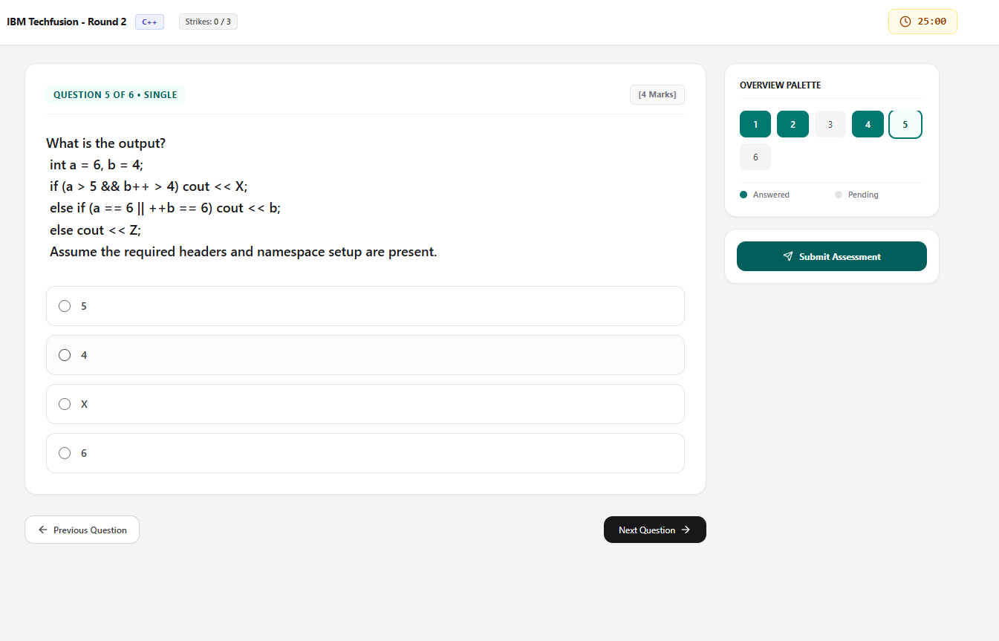

# Secure Proctored Assessment Platform

## 💡 Overview
The Secure Proctored Assessment Platform is a robust, live examination environment built for educational institutions and technical recruiters. Designed to handle high-stakes assessments (like 3-hour coding competitions or case studies), the platform enforces strict anti-cheat proctoring while delivering a seamless, glitch-free experience for candidates.

> "A bulletproof testing environment that balances strict security with intelligent candidate assistance."

Beyond standard question delivery, the platform features a highly configurable admin architecture. Admins can create dynamic language or subject tracks, bulk-import questions via CSV, and enable a tightly controlled, rate-limited AI Assistant powered by Google Gemini to help students with structural guidance during complex case studies. 

## ✨ Features
- 🔐 **Secure Authentication** — Persistent sessions with silent token auto-refresh via Supabase Auth to ensure candidates are never logged out mid-exam.
- ⏱️ **Bulletproof Server-Anchored Timer** — Countdown logic tied to a database-stored real-world `end_time` timestamp, completely immune to PC sleep exploits, page refreshes, and network drops.
- 🛡️ **Anti-Cheat Proctoring** — Strict 3-strike fullscreen enforcement. Exiting fullscreen or switching tabs logs a violation. Reaching 3 strikes results in automatic disqualification.
- 🧠 **Configurable AI Assistant** — Integrated Google Gemini (`gemini-3.8-flash`) provides structural hints. Admins can dynamically configure the maximum allowed queries per student and the AI response word limit directly from the dashboard.
- 🔀 **Dynamic Category Tracks** — Admins can enable custom selection screens (e.g., "Select your Tech Stack: React, Java, Python") with customizable titles and instructions that lock candidates into a specific question track.
- 📁 **CSV Bulk Import** — Quickly construct exams by downloading a template and uploading hundreds of questions (Single Choice, Multiple Choice, True/False, Descriptive) in seconds.
- ⚡ **Real-Time Terminations** — Powered by Supabase Realtime WebSockets, admins can instantly terminate a candidate's live session, immediately locking their screen and submitting their current progress.
- 📊 **Flexible Scoring Engine** — Support for custom positive marks and negative mark penalties for incorrect answers.
- 🛠️ **Admin Dashboard** — Create, edit, and publish exams, toggle result visibility, and view live candidate submissions and leaderboards.

## 👩‍💻 Tech Stack
**Backend (BaaS)**
- Supabase PostgreSQL (Database)
- Supabase Auth (Authentication & Session Management)
- Supabase Realtime (WebSocket subscriptions for live terminations)
- AI Integration: Google Gemini API (`gemini-3.8-flash`)

**Frontend**
- React
- React Router DOM (Navigation)
- Tailwind CSS (Styling)
- Lucide React (Icons)
- Build Tool: Vite

## 📦 Getting Started
To get a local copy of this project up and running, follow these steps.

### 🚀 Prerequisites
- Node.js and npm
- A free [Supabase](https://supabase.com/) account and project
- A free [Google AI Studio](https://aistudio.google.com/) API key for Gemini

### 🛠️ Installation

1. **Clone the repository:**
   ```bash
   git clone https://github.com/tech697info-stack/proctored-exam-portal.git
   cd proctored-exam-portal
   ```

2. **Install dependencies:**
   ```bash
   npm install
   ```

3. **Configure Environment Variables:**
   Create a `.env` file in the root directory and add your keys:
   ```env
   VITE_SUPABASE_URL=your_supabase_project_url
   VITE_SUPABASE_ANON_KEY=your_supabase_anon_key
   VITE_GEMINI_API_KEY=your_gemini_api_key
   ```

4. **Database Setup (Supabase SQL Editor):**
   Go to the SQL Editor in your Supabase dashboard, paste the following complete schema query, and click "Run" to initialize your tables, triggers, and security policies:

   ```sql
   -- =========================================================
   -- 1. PROFILES & AUTH TRIGGER
   -- =========================================================
   CREATE TABLE IF NOT EXISTS public.profiles (
     id UUID REFERENCES auth.users ON DELETE CASCADE PRIMARY KEY,
     email TEXT NOT NULL,
     full_name TEXT,
     role TEXT CHECK (role IN ('admin', 'student')) DEFAULT 'student',
     created_at TIMESTAMPTZ DEFAULT timezone('utc'::text, now()) NOT NULL
   );

   CREATE OR REPLACE FUNCTION public.handle_new_user()
   RETURNS trigger AS $$ BEGIN INSERT INTO public.profiles (id, email, full_name, role) VALUES ( new.id, new.email, COALESCE(new.raw_user_meta_data->>'full_name', 'Student'), COALESCE(new.raw_user_meta_data->>'role', 'student') ) ON CONFLICT (id) DO UPDATE SET full_name = EXCLUDED.full_name, email = EXCLUDED.email; RETURN new; END; $$ LANGUAGE plpgsql SECURITY DEFINER;

   DROP TRIGGER IF EXISTS on_auth_user_created ON auth.users;
   CREATE TRIGGER on_auth_user_created
     AFTER INSERT ON auth.users
     FOR EACH ROW EXECUTE PROCEDURE public.handle_new_user();

   -- =========================================================
   -- 2. EXAMS TABLE
   -- =========================================================
   CREATE TABLE IF NOT EXISTS public.exams (
     id UUID DEFAULT gen_random_uuid() PRIMARY KEY,
     title TEXT NOT NULL,
     description TEXT,
     duration_minutes INTEGER NOT NULL,
     start_window TIMESTAMPTZ,
     end_window TIMESTAMPTZ,
     is_published BOOLEAN DEFAULT false,
     is_ended BOOLEAN DEFAULT false,
     show_results BOOLEAN DEFAULT false,
     show_detailed_results BOOLEAN DEFAULT false,
     show_leaderboard BOOLEAN DEFAULT false,
     has_categories BOOLEAN DEFAULT false,
     allow_ai_assistant BOOLEAN DEFAULT false,
     category_selection_title text DEFAULT 'Select Your Track',
     category_selection_message text DEFAULT 'Please select the track you wish to be tested on. You cannot change this later.',
     ai_word_limit integer DEFAULT 500,
     ai_attempts_limit integer DEFAULT 2,
     created_by UUID REFERENCES public.profiles(id),
     created_at TIMESTAMPTZ DEFAULT timezone('utc'::text, now()) NOT NULL
   );

   -- =========================================================
   -- 3. QUESTIONS TABLE
   -- =========================================================
   CREATE TABLE IF NOT EXISTS public.questions (
     id UUID DEFAULT gen_random_uuid() PRIMARY KEY,
     exam_id UUID REFERENCES public.exams(id) ON DELETE CASCADE NOT NULL,
     question_text TEXT NOT NULL,
     type TEXT CHECK (type IN ('single', 'multiple', 'boolean', 'text')) NOT NULL,
     options JSONB NOT NULL DEFAULT '[]'::jsonb,
     correct_answers JSONB NOT NULL DEFAULT '[]'::jsonb,
     marks NUMERIC DEFAULT 1,
     negative_marks NUMERIC DEFAULT 0,
     category TEXT DEFAULT 'General',
     created_at TIMESTAMPTZ DEFAULT timezone('utc'::text, now()) NOT NULL
   );

   -- =========================================================
   -- 4. SUBMISSIONS TABLE
   -- =========================================================
   CREATE TABLE IF NOT EXISTS public.submissions (
     id UUID DEFAULT gen_random_uuid() PRIMARY KEY,
     exam_id UUID REFERENCES public.exams(id) ON DELETE CASCADE NOT NULL,
     student_id UUID REFERENCES public.profiles(id) ON DELETE CASCADE NOT NULL,
     student_name TEXT,
     student_email TEXT,
     mobile_number TEXT,
     department TEXT,
     academic_year TEXT,
     selected_category TEXT DEFAULT NULL,
     answers JSONB NOT NULL DEFAULT '{}'::jsonb,
     manual_grades JSONB DEFAULT '{}'::jsonb,
     is_reviewed BOOLEAN DEFAULT false,
     score NUMERIC DEFAULT 0,
     violations_count INTEGER DEFAULT 0,
     is_terminated BOOLEAN DEFAULT false,
     status TEXT DEFAULT 'in_progress',
     time_taken_seconds INTEGER DEFAULT 0,
     ai_usage_count INTEGER DEFAULT 0,
     is_qualified BOOLEAN DEFAULT NULL,
     end_time timestamptz,
     submitted_at TIMESTAMPTZ DEFAULT timezone('utc'::text, now()) NOT NULL,
     UNIQUE (exam_id, student_id)
   );

   -- =========================================================
   -- 5. PERFORMANCE INDEXES
   -- =========================================================
   CREATE INDEX IF NOT EXISTS idx_submissions_exam_student ON public.submissions(exam_id, student_id);
   CREATE INDEX IF NOT EXISTS idx_submissions_leaderboard ON public.submissions (exam_id, score DESC, time_taken_seconds ASC, submitted_at ASC);
   CREATE INDEX IF NOT EXISTS idx_questions_exam_id ON public.questions(exam_id);
   CREATE INDEX IF NOT EXISTS idx_exams_published ON public.exams(is_published);
   CREATE INDEX IF NOT EXISTS idx_profiles_role ON public.profiles(role);

   -- =========================================================
   -- 6. LEADERBOARD RPC FUNCTION
   -- =========================================================
   DROP FUNCTION IF EXISTS public.get_exam_leaderboard;
   CREATE OR REPLACE FUNCTION public.get_exam_leaderboard(target_exam_id UUID)
   RETURNS TABLE (
       student_id UUID,
       student_name TEXT,
       score NUMERIC,
       time_taken_seconds INTEGER
   ) 
   LANGUAGE sql
   SECURITY DEFINER 
   AS $$ SELECT student_id, student_name, score, time_taken_seconds FROM public.submissions WHERE exam_id = target_exam_id AND is_terminated = false ORDER BY score DESC, time_taken_seconds ASC, submitted_at ASC; $$;

   -- =========================================================
   -- 7. ROW-LEVEL SECURITY (RLS) POLICIES
   -- =========================================================
   ALTER TABLE public.profiles ENABLE ROW LEVEL SECURITY;
   ALTER TABLE public.exams ENABLE ROW LEVEL SECURITY;
   ALTER TABLE public.questions ENABLE ROW LEVEL SECURITY;
   ALTER TABLE public.submissions ENABLE ROW LEVEL SECURITY;

   DROP POLICY IF EXISTS "Allow read profiles" ON public.profiles;
   DROP POLICY IF EXISTS "Allow update self" ON public.profiles;
   DROP POLICY IF EXISTS "Allow read published exams" ON public.exams;
   DROP POLICY IF EXISTS "Allow admin modify exams" ON public.exams;
   DROP POLICY IF EXISTS "Allow read questions" ON public.questions;
   DROP POLICY IF EXISTS "Allow admin modify questions" ON public.questions;
   DROP POLICY IF EXISTS "Allow student insert/view own" ON public.submissions;

   CREATE POLICY "Allow read profiles" ON public.profiles 
     FOR SELECT TO authenticated USING (true);

   CREATE POLICY "Allow update self" ON public.profiles 
     FOR UPDATE TO authenticated USING (auth.uid() = id);

   CREATE POLICY "Allow read published exams" ON public.exams 
     FOR SELECT TO authenticated 
     USING (is_published = true OR EXISTS (SELECT 1 FROM public.profiles WHERE public.profiles.id = auth.uid() AND public.profiles.role = 'admin'));

   CREATE POLICY "Allow admin modify exams" ON public.exams 
     FOR ALL TO authenticated 
     USING (EXISTS (SELECT 1 FROM public.profiles WHERE public.profiles.id = auth.uid() AND public.profiles.role = 'admin'))
     WITH CHECK (EXISTS (SELECT 1 FROM public.profiles WHERE public.profiles.id = auth.uid() AND public.profiles.role = 'admin'));

   CREATE POLICY "Allow read questions" ON public.questions 
     FOR SELECT TO authenticated USING (true);

   CREATE POLICY "Allow admin modify questions" ON public.questions 
     FOR ALL TO authenticated 
     USING (EXISTS (SELECT 1 FROM public.profiles WHERE public.profiles.id = auth.uid() AND public.profiles.role = 'admin'))
     WITH CHECK (EXISTS (SELECT 1 FROM public.profiles WHERE public.profiles.id = auth.uid() AND public.profiles.role = 'admin'));

   CREATE POLICY "Allow student insert/view own" ON public.submissions 
     FOR ALL TO authenticated 
     USING (auth.uid() = student_id OR EXISTS (SELECT 1 FROM public.profiles WHERE public.profiles.id = auth.uid() AND public.profiles.role = 'admin'))
     WITH CHECK (auth.uid() = student_id OR EXISTS (SELECT 1 FROM public.profiles WHERE public.profiles.id = auth.uid() AND public.profiles.role = 'admin'));

   -- =========================================================
   -- 8. REALTIME REPLICATION
   -- =========================================================
   DO $$ BEGIN IF NOT EXISTS ( SELECT 1 FROM pg_publication_tables WHERE pubname = 'supabase_realtime' AND tablename = 'submissions' ) THEN ALTER PUBLICATION supabase_realtime ADD TABLE public.submissions; END IF; END $$;
   ```
   
   -- Exams Table Updates (Admin Configurations)
   ALTER TABLE exams 
   ADD COLUMN IF NOT EXISTS category_selection_title text DEFAULT 'Select Your Track',
   ADD COLUMN IF NOT EXISTS category_selection_message text DEFAULT 'Please select the track you wish to be tested on. You cannot change this later.',
   ADD COLUMN IF NOT EXISTS ai_word_limit integer DEFAULT 200,
   ADD COLUMN IF NOT EXISTS ai_attempts_limit integer DEFAULT 2;
   ```

5. **Run the development server:**
   ```bash
   npm run dev
   ```
   Open `http://localhost:5173` to view the app in your browser.

## 🤖 AI Assistant Setup (Optional)
The platform features an optional AI guide to assist students during complex descriptive questions.
1. Generate an API key from Google AI Studio.
2. Add it to your `.env` file as `VITE_GEMINI_API_KEY`.
3. When creating an exam in the Admin dashboard, check the **"Enable AI Assistant"** box to reveal configurations for the word limit and maximum queries per student.

## 📸 Preview

**1. Live Examination Interface**
*Candidates experience a clean, distraction-free environment with a live overview palette, category indicators, and a secure countdown timer.*


**2. Anti-Cheat Security System**
*Strict fullscreen enforcement logs violations if a candidate navigates away or opens a new tab, culminating in automatic disqualification.*


**3. Advanced Assessment Configurations**
*Admins have complete control over exam parameters, including AI Assistant rate limits, category toggles, and duration.*


**4. Automated Leaderboards & Cutoffs**
*Real-time rankings based on score and completion time, featuring a built-in cutoff tool to qualify top candidates for subsequent rounds.*


**5. Dynamic Track Selection**
*Admins can configure mandatory category selections before an exam begins, securely routing candidates to specific technology tracks.*


**6. Admin Examination Console**
*A comprehensive dashboard for instructors to manage assessment lifecycles, toggle answer key visibility, and monitor live statuses.*


## 🤝 Contributing
We welcome contributions to this project. Please follow these steps to contribute:
1. Fork the repository.
2. Create a new branch (`git checkout -b feature/your-feature-name`).
3. Make your changes and commit them (`git commit -m 'Add some feature'`).
4. Push to the branch (`git push origin feature/your-feature-name`).
5. Open a pull request.

## 🐛 Issues
If you encounter any issues while using or setting up the project, please check the Issues section to see if it has already been reported. If not, feel free to open a new issue detailing the problem.

When reporting an issue, please include:
- A clear and descriptive title.
- A detailed description of the problem.
- Steps to reproduce the issue.
- Any relevant console errors or screenshots.

## 📜 License
Distributed under the MIT License. See `LICENSE` for more information.
